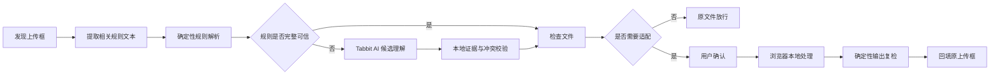

# 传送门

> AI 读懂上传墙，本地引擎安全地跨过去。

传送门（技术标识：UploadFit）是一款运行在 Tabbit Browser 中的纯 JavaScript 插件。它识别当前网页上传框的格式、体积、尺寸和时长要求，在用户遇到“不支持该格式”或“文件过大”时，于浏览器本地完成最小必要适配，并把合规文件放回原上传框。

它不是另一个需要打开的压缩网站，而是补上用户上传流程的“最后一公里”。

## 项目简介

用户上传证件照、报名图片或长录音时，经常直到最后一步才发现格式不符、图片过大、音频超过体积上限。传统做法是离开当前页面，寻找转换工具，下载结果，再返回原网站重新上传。

传送门让这个过程留在原网页中：

- 自动发现普通及动态插入的文件上传框；
- 优先用确定性代码读取 `accept` 属性、附近说明和同页拒收提示；
- 本地规则不完整时，调用 Tabbit 官方 AI 理解经过筛选的相关文字；
- 检查文件真实签名、容器、体积、尺寸或音频元数据；
- 在有损处理前说明方案并取得用户确认；
- 在浏览器本地压缩或转换，复检合格后安全回填；
- 不替用户点击最终提交按钮。

## 核心能力

| 场景 | 输入 | 可执行适配 | 输出 |
|---|---|---|---|
| 图片上传 | JPEG、PNG、WebP | 格式转换、体积压缩、尺寸调整、方向修复；裁剪、放大和透明背景变化按风险确认 | 满足页面明确规则的 JPEG、PNG 或 WebP |
| 长语音转写 | MP3 | 文件超限时按页面上限和时长计算目标码率并重新编码 | MP3 |
| 常见录音格式 | PCM WAV | 页面明确允许 MP3 时，经确认转码并压缩 | MP3 |
| 手机与会议录音 | 常见非加密、非 fragmented 的 AAC-LC M4A | 页面明确允许 MP3 时，经确认解码并转码 | MP3 |
| 已经合规的文件 | 支持集合内的图片或音频 | 不做多余处理，保留原文件 | 原文件直接放行 |

所有能力都以网页存在可信、可执行规则为前提。规则缺失、相互冲突或处理结果无法复检时，传送门会停止并解释原因。

## AI 在哪里

AI 不是压缩器，也没有网页执行权。它只承担自然语言规则理解：

1. 插件从当前上传器附近提取与规则相关的短文本；
2. 确定性解析器先提取明确格式、数字和单位；
3. 只有本地规则不完整或置信度不足时，才调用 Tabbit 官方 `LLMBridge.chat()`；
4. AI 返回固定 JSON 结构的候选规则和原文证据；
5. 本地代码检查 Schema、数值范围、证据溯源和规则冲突；
6. 通过验证的候选才会进入规则合并，且优先级低于站点适配器、明确拒收、HTML 属性和附近文字。

AI 不接收图片、音频、文件名、Base64、PCM、频谱、Cookie、Token 或完整网页内容。AI 不可用、超时或输出不合规时，基础能力继续使用本地规则运行。

## 工作流程



## 在 Tabbit 中使用

### 直接安装生产脚本

1. 获取或构建 [`dist/uploadfit.js`](dist/uploadfit.js)。
2. 打开文件并复制全部纯 JavaScript 内容。
3. 在 Tabbit 中创建“脚本”妙招并粘贴代码。
4. 将生效范围限制为需要使用的网页，保存并启用。
5. 刷新目标页面，然后照常选择文件。
6. 如果传送门提示将执行有损处理，检查规则证据与预计输出后再确认。

Tabbit 只加载粘贴后的单文件脚本。修改本地源码或重新构建不会自动更新已经保存的妙招，更新版本时需要重新粘贴并保存。

不要把源码目录、ESM `import` 语句或 Markdown 代码围栏粘贴进 Tabbit。生产物是一个自包含 IIFE，不需要模块加载器、CDN或远程运行时依赖。

## 已验证的真实场景

### Podcastools 音频转写

页面规则为最大 10MB、最长10分钟：

- 12,000,000-byte、5分钟、320kbps MP3；
- 经用户确认后重新编码为 8,400,672-byte、224kbps MP3；
- 输出复检通过并回填，业务提交点击次数为0。

一份 30,481,920-byte 的测试 MP3 约12.7分钟，超过页面10分钟上限。传送门会正确报告时长不可修复，而不会谎称仅压缩体积就能使其合规。

### VocaText 音频上传

- 30,000,000-byte PCM WAV 触发页面 25MB 拒收提示；
- 传送门捕获短生命周期提示并形成一次受控重试；
- 输出 6,251,520-byte MP3，未自动点击业务提交。

### Zent v7 图片上传

- 识别 JPEG/PNG 与 1,000,000-byte 上限；
- 单文件输入从 4,944,335 bytes 压缩至 890,624 bytes；
- 页面虽然允许选择多个文件，但实际多文件选择仍保持不处理。

公开网站可能随时修改页面结构或规则。项目同时保留本地稳定夹具用于回归，不把一次公开站点成功写成永久兼容承诺。

## 明确边界

传送门解决格式、体积和图片尺寸造成的上传障碍，但不会尝试绕过业务规则。

当前不会执行：

- 替代证件照官方审核、人脸核验或网站专用审核工具；
- 解决账号权限、登录状态、服务端额度、网络或网站自身故障；
- 自动点击“提交”“转写”“发布”等最终业务按钮；
- 音频裁剪、分段、合并、降噪、人声增强、变速或内容理解；
- 视频抽取音轨或批量处理多个文件；
- 支持所有 M4A/MP3 profile、加密媒体或损坏文件；
- 在页面没有可信最大字节数、没有明确允许输出格式或规则冲突时猜测执行。

对音频而言，压缩体积不会改变时长。页面只有时长墙，或者文件同时超过不可修改的时长上限时，当前版本会安全停止。

## 隐私与安全

- 图片和音频内容只在浏览器内存中处理；
- 生产代码不通过 `fetch`、XHR、WebSocket、EventSource 或 `sendBeacon` 外传媒体；
- 音频编解码运行在有界 Blob Worker 中，并限制队列、PCM 和容器表预算；
- AI 只接收经过筛选、清洗和长度限制的规则文本；
- 密码、验证码、Token、带查询参数的 URL、长数字串和疑似 Base64 会阻止 AI 调用；
- 失败、取消、完成、关闭或刷新时清理 Worker、对象 URL 和临时资源；
- 处理结果必须再次检查格式、体积、尺寸或音频元数据，复检失败不会回填；
- 用户保留原文件和最终提交决定。

## 本地构建

环境要求：Node.js 22.20+、npm 10.9.3+。

```powershell
npm ci
npm run build
```

生成的生产文件：

```text
dist/uploadfit.js
```

常用验证命令：

```powershell
npm run check
npm run test:e2e -- --reporter=line --workers=1
```

- `npm run check`：运行 Vitest、生成 production IIFE，并执行静态安全检查。
- `npm run test:e2e`：构建测试包、启动临时本地服务并运行浏览器回归，结束后关闭测试服务。
- `npm run build:dev`：生成包含测试诊断能力的开发包；不得作为正式发布物。

## 当前验收状态

截至 2026-08-25，发布前最终代码审计结果：

- `npm run check`：25个测试文件、252项测试通过；
- production build 与 static-check 通过；
- 当前 `dist/uploadfit.js`：446,208 bytes；
- SHA-256：`C7E3D59FA0B44B0EC2104B34AE7FFB040A577B6E8A8B18F6DB4F79241D5C79A8`；
- Tabbit production 启动、动态上传器发现、重复加载幂等和真实 AI 调用均已有实机证据；
- Podcastools、VocaText 和 Zent v7 的目标场景已有真实网页验证。

核心代码已经通过发布前审计，但当前仓库仍处于 V2-S5 发布候选准备阶段，不应提前标记为正式公开版本。发布前还需要统一版本号、候选清单、最终产物 SHA、安装/更新烟测和完整分发材料。

## 技术结构

```text
src/
├─ dom/          上传框发现、上下文提取、拒收观察
├─ rules/        确定性解析、规范化、来源合并与冲突裁决
├─ providers/    Tabbit AI Provider 与输出验证
├─ image/        图片检查、计划、Canvas/Worker 处理与复检
├─ audio/        音频签名、元数据、规划、解码、编码与复检
├─ core/         任务状态机、媒体 handler 和会话生命周期
├─ injection/    File 回填、事件释放与失败降级
└─ ui/           状态卡、规则证据、确认与取消交互
```

最终运行时由构建系统打包为一个可直接粘贴的纯 JavaScript IIFE。

## 许可证与分发

仓库当前仍标记为 `private: true` / `license: UNLICENSED`。音频编码使用精确锁定的 `lamejs@1.2.1`，正式分发必须同时提供相应 NOTICE、完整许可证、同版本可构建源码、lockfile 以及替换重建说明。

裸 `dist/uploadfit.js` 或单独的 Tabbit 分享链接不构成完整合规发行包。在许可证与发布材料完成前，请勿擅自公开再分发。

相关材料：

- [`docs/decisions/ADR-005-V2-S0-音频编解码方案.md`](docs/decisions/ADR-005-V2-S0-音频编解码方案.md)
- [`docs/evidence/V2-S0/licenses/NOTICE.md`](docs/evidence/V2-S0/licenses/NOTICE.md)
- [`docs/evidence/V2-S0/licenses/RELINKING.md`](docs/evidence/V2-S0/licenses/RELINKING.md)

## 文档导航

- [`docs/v2/UploadFit-PRD-v2.0.md`](docs/v2/UploadFit-PRD-v2.0.md)：V2 产品范围、功能契约和验收口径；
- [`docs/progress.md`](docs/progress.md)：阶段进度与验收记录；
- [`docs/handoffs/V2-final-code-audit.md`](docs/handoffs/V2-final-code-audit.md)：发布前最终代码审计；
- [`docs/handoffs/V2-podcastools-mp3-filename-fix.md`](docs/handoffs/V2-podcastools-mp3-filename-fix.md)：Podcastools MP3 回归修复；
- [`docs/testing-sites.md`](docs/testing-sites.md)：公开网站和本地回归夹具；
- [`docs/decisions/`](docs/decisions/)：架构决策记录；
- [`docs/evidence/`](docs/evidence/)：结构化及视觉验收证据；
- [`docs/archive/v1/`](docs/archive/v1/)：V1 图片阶段归档。
