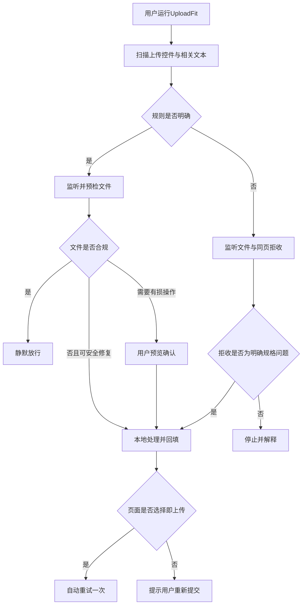
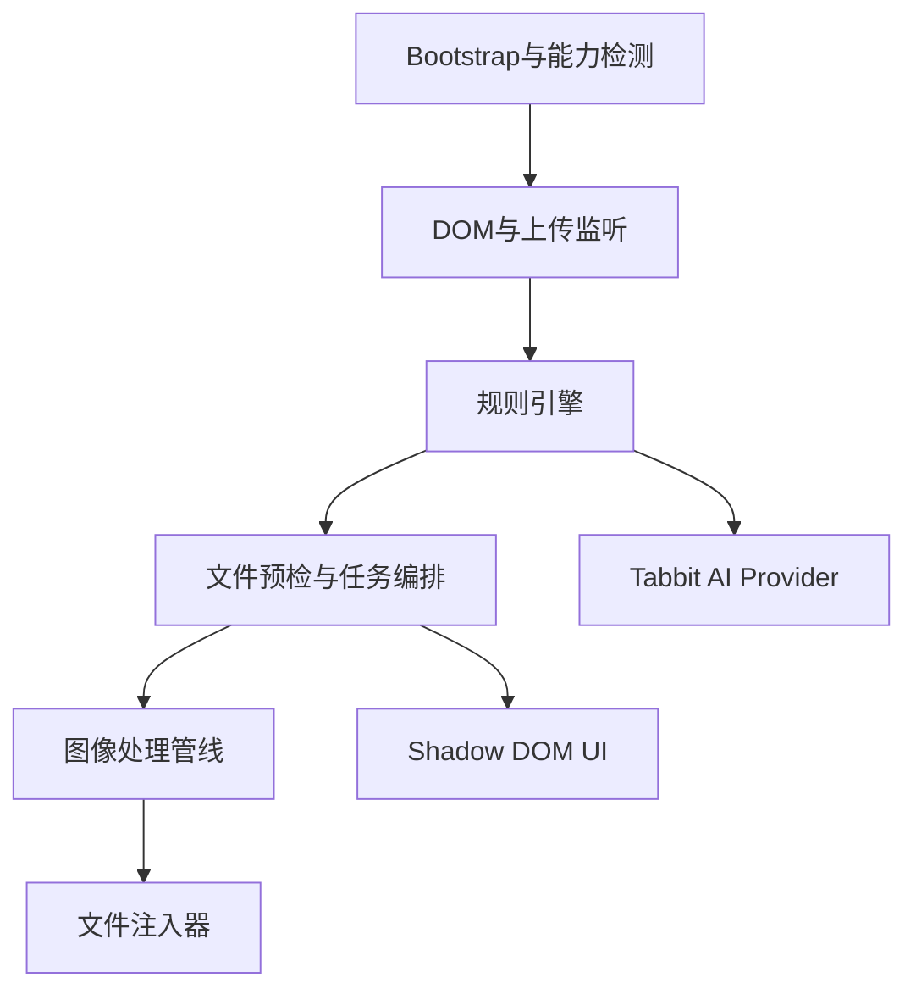

# UploadFit 产品需求文档（PRD）

> 面向 2026 AI Hackathon「03 Tabbit 浏览器：用脚本妙招，解决上网烦恼」赛道<br>
> 文档版本：v1.0<br>
> 文档状态：可进入开发<br>
> 更新日期：2026-08-17<br>
> 默认实施条件：单人开发、5 个开发日、JavaScript、最新版 Tabbit PC 浏览器<br>
> 产品名：UploadFit（暂定，可在提交前更名）

---

## 0. 一页结论

### 0.1 产品是什么

UploadFit 是一个按需运行的 Tabbit「脚本妙招」。用户在报名、考试、招聘、政务或办公网页上传图片时，脚本读取当前网页的上传说明、上传控件和拒收提示，把自然语言限制整理为结构化规则；当用户选择的图片不符合格式、体积、像素或比例要求时，在本地完成转码、缩放、压缩和必要的裁剪确认，再将新文件放回原网页上传控件。

核心体验：

> 用户不再退出网页、搜索压缩工具、下载文件、反复试错；UploadFit 在原上传流程里补齐“文件与网页要求之间的最后一公里”。

### 0.2 MVP真正承诺什么

MVP承诺解决：

- 当前页面存在普通单文件图片上传控件；
- 文件类型为 JPG、JPEG、PNG 或 WebP；
- 页面能明确表达格式、体积、像素、宽高或比例限制；
- 或者页面在不跳转的情况下显示明确的文件规格拒收原因；
- 修复可以通过转码、压缩、缩放、EXIF方向修正或用户确认裁剪完成。

MVP不承诺解决：

- 所有“上传失败”；
- 页面跳转后才显示错误的传统表单；
- 网站要求必须由官方照片审核工具生成的私有文件签名；
- 人脸位置、服装、背景颜色、内容真实性等人工审核问题；
- HEIC、PDF、Word、音视频、压缩包；
- 依赖可信事件 `event.isTrusted=true` 才会启动上传的网站；
- closed Shadow DOM、跨域 iframe 或完全自绘的文件选择器；
- 绕过登录、权限、付费、安全审核或网站业务规则。

### 0.3 为什么不是“看到上传失败就压缩”

上传失败还可能来自网络错误、登录失效、服务端异常、文件损坏或内容违规。UploadFit只有在识别出明确且可修复的文件规格规则后才处理；遇到“上传失败”“系统繁忙”等模糊错误时必须停止，不能盲目压缩和循环重试。

### 0.4 核心方案

采用“提前预检 + 拒收兜底”的混合触发：

1. 用户手动运行脚本；
2. 脚本读取上传控件附近的说明、HTML属性和相关页面文本；
3. 确定性解析器优先提取规则，Tabbit AI按需补充理解自然语言；
4. 用户选择文件；
5. 规则明确时先预检，避免无效上传；
6. 规则起初不明确时允许网页处理，并监听同页拒收提示；
7. 仅在拒收原因明确可修复时处理原文件；
8. 自动替换原上传控件，选择即上传的网站最多自动重试一次；
9. 需要点击提交的网站只替换文件，不代替用户提交；
10. 涉及裁剪、透明背景转白底或低分辨率放大时，必须先由用户确认。

### 0.5 技术结论

- 语言：JavaScript，不使用TypeScript；
- 构建：模块化源码，经esbuild打包为单个IIFE脚本；
- 图像引擎：浏览器原生File、Blob、Canvas、createImageBitmap；
- 文件回填：DataTransfer + input.files + input/change事件；
- 性能增强：Worker/OffscreenCanvas能力检测，失败时退回主线程；
- AI：只负责把相关网页文本转换为候选规则，不接收图片，不直接执行网页操作；
- 数据：文件只在本地内存处理，不上传服务器，不保存浏览历史；
- 体积策略：`dist/uploadfit.js`不设置固定KB/bytes上限；记录minified raw bytes、SHA-256和构建差异，体积仅作优化观察项，不阻断验收；
- UI：一个轻量浮动状态胶囊和按需出现的操作卡片，不做侧边栏。

---

## 1. 文档目的

本文档同时承担以下作用：

1. 产品范围说明；
2. 交互与状态机定义；
3. 技术架构与接口设计；
4. 图像处理算法规格；
5. 数据、安全和异常边界；
6. 测试用例与验收标准；
7. 五日开发排期；
8. 黑客松提交材料清单；
9. 三分钟演示脚本；
10. 开发过程中发生取舍时的裁决依据。

如代码实现与本文档冲突，以“安全边界 > P0验收标准 > 产品状态机 > 具体实现建议”的顺序裁决。

---

## 2. 赛道约束与合规映射

### 2.1 必须交付

| 赛道要求 | UploadFit对应交付 |
|---|---|
| Tabbit脚本妙招形态 | 单个可安装、可运行、可复用的JavaScript脚本 |
| 可安装链接 | Tabbit妙招广场或比赛指定渠道链接 |
| 完整代码及说明 | `src/`、`dist/uploadfit.js`、README、本文PRD |
| 不超过3分钟演示视频 | 按第28章脚本录制 |
| 一页作品说明 | `docs/index.html`，内容见第27章 |
| 至少一个评委测试页面 | 自建稳定测试页 + 一个真实公开网页 |
| 记录运行结果 | 测试结果表、截图或短视频，放入 `docs/test-results.md` |

### 2.2 “读取网页并改造网页”的满足方式

UploadFit运行后必须完成：

1. 读取当前网页中与上传有关的控件、说明、标签、提示或用户选中文字；
2. 把这些内容解析为图片限制规则；
3. 在原网页右下角增加UploadFit状态胶囊；
4. 在需要处理时增加规则卡、进度卡、裁剪确认卡或结果卡；
5. 将适配后的文件直接写回原网页上传控件；
6. 不只在Tabbit聊天窗口返回文字。

### 2.3 AI在本产品中的位置

AI不是图片压缩器，也没有执行权。AI只做自然语言理解：

- 输入：与当前上传控件有关、经过裁剪和脱敏的网页文本；
- 输出：符合固定JSON结构的候选规则；
- 校验：所有AI输出必须经过确定性代码验证；
- 执行：只有代码确认规则自洽且置信度达到阈值后，图像处理器才可执行；
- 降级：AI接口不可用、超时或输出不合规时，继续使用确定性规则，不阻塞基础能力；
- 隐私：不得把原始文件、图片像素、完整页面、用户姓名或文件名发送给模型。

### 2.4 安全红线

UploadFit不得：

- 绕过登录、付费、访问控制或网站安全限制；
- 读取与上传任务无关的页面内容；
- 采集、存储或上传用户浏览历史；
- 批量抓取个人信息；
- 自动点击最终发布、报名提交、购买、付款或删除按钮；
- 为规避内容审核而改造图片；
- 对不明确的上传错误反复重试；
- 把用户文件上传到UploadFit自有服务器；
- 伪装处理成功或隐藏图片质量损失。

---

## 3. 背景与问题定义

### 3.1 典型问题

中国PC网页中的考试、招聘、资格申请、政务和企业系统，仍普遍使用严格且不统一的图片限制，例如：

- 只接受JPG；
- 文件必须在30KB至120KB之间；
- 必须是390×567像素；
- 宽度不低于295像素且高度不低于413像素；
- 只能上传单张图片；
- PNG需要转成JPG；
- 手机照片方向错误；
- 网站直到上传后才告诉用户哪里不合格。

用户当前通常需要：

1. 记住或复制网页限制；
2. 离开当前页面；
3. 搜索图片压缩或裁剪网站；
4. 上传包含个人信息的照片到第三方网站；
5. 猜测压缩比例；
6. 下载文件；
7. 返回原页面重新选择；
8. 继续试错。

### 3.2 核心痛点

不是“用户不会压缩图片”，而是：

> 网页知道自己要什么，用户手里有一个文件，但两者之间没有自动适配层。

### 3.3 产品机会

浏览器脚本同时接近三类关键信息：

- 页面要求；
- 用户刚刚选择的本地文件；
- 原上传控件和错误反馈。

独立压缩网站和通用Agent通常拿不到完整的原网页交互上下文；浏览器脚本天然适合完成这一步。

### 3.4 严肃限制

这是高痛点、低至中频的工具，不应包装成每日高频平台。产品价值来自关键节点的高挽救率，而不是日活。MVP的成功标准应是“在用户卡住的那一次明显省事”，而不是强行培养日常打开习惯。

---

## 4. 产品定位

### 4.1 一句话定位

自动读懂网页上传要求，并把用户的图片就地改到能上传。

### 4.2 用户工作定义（JTBD）

当我在网页上传图片却不符合要求时，我希望不离开当前页面就把文件调整合格，并继续原流程，避免寻找工具、泄露文件和反复试错。

### 4.3 目标用户

P0用户：

- 使用PC报名考试、投递简历、申请资格或办理政务的人；
- 不熟悉图像编辑、尺寸和文件格式的人；
- 熟悉工具但不愿为一次上传打开多个网站的人。

P1用户：

- 频繁使用后台CMS、企业OA、商家后台上传图片的运营人员；
- 需要批量处理平台素材的内容人员。

### 4.4 目标场景优先级

| 优先级 | 场景 | MVP支持 |
|---|---|---:|
| P0 | 考试、招聘、资格申请、政务证件照 | 是 |
| P0 | 单张材料扫描图的体积/格式适配 | 是 |
| P1 | CMS、OA、内容后台封面图 | 核心兼容，暂不专项适配 |
| P1 | 拖拽上传区 | 后续 |
| P1 | 多文件批量上传 | 后续 |
| P2 | HEIC照片 | 后续，需要WASM编解码器 |
| P2 | PDF合并、压缩、拆分 | 后续 |
| P2 | 音视频转码与分割 | 后续 |

---

## 5. 产品目标、非目标与指标

### 5.1 MVP目标

- G1：用户运行脚本后，明确感知UploadFit已在当前网页工作；
- G2：识别普通文件输入框及其附近的图片限制；
- G3：准确判断JPG/JPEG/PNG/WebP文件是否符合规则；
- G4：在本地完成可安全自动化的转码、压缩和缩放；
- G5：涉及裁剪、透明背景或低清放大时获得用户确认；
- G6：把处理结果放回原上传框；
- G7：同页明确拒收时最多自动修复并重试一次；
- G8：无法安全修复时给出清楚原因，不盲目尝试；
- G9：在一个真实公开网页和一个稳定测试页上可完整体验；
- G10：符合赛道的数据、安全和交付要求。

### 5.2 非目标

- 不做完整图片编辑器；
- 不做长期文件库；
- 不做账号、云同步或跨设备历史；
- 不做通用网页Agent；
- 不做图片内容美化、换背景、人脸重绘；
- 不保证通过人工资格审核；
- 不自动完成表单提交；
- 不覆盖任意文件类型；
- 不以侧边栏承载复杂工作台。

### 5.3 质量指标

| 指标 | MVP门槛 | 理想值 |
|---|---:|---:|
| 规则解析准确率 | ≥90%，且无高风险误执行 | ≥95% |
| 确定性规则测试通过率 | 100% | 100% |
| 图片输出满足结构化规则 | ≥95% | ≥98% |
| 测试页端到端成功率 | ≥90% | ≥95% |
| 模糊错误误触发处理率 | 0% | 0% |
| 同一文件自动重试次数 | ≤1 | 1 |
| 10MB常规照片处理时间 | ≤5秒 | ≤3秒 |
| 主线程连续冻结 | 不得超过500ms | 不得超过150ms |
| 生产脚本体积 | 记录minified raw bytes和SHA-256，不设固定上限、不阻断 | 在功能、安全和兼容优先的前提下持续优化 |
| 文件上传至自有服务 | 0 | 0 |
| 未经确认自动提交 | 0 | 0 |

处理时间以评委常见PC、最新版Tabbit、4000×3000左右JPG为参考，不对超大图片承诺固定时延。

### 5.4 黑客松成功标准

必须同时满足：

1. 评委能安装；
2. 评委能在真实网页看到脚本读取页面并新增功能；
3. 评委能在测试页上传一个不合规文件；
4. 脚本能明确展示识别到的规则；
5. 脚本能处理文件并写回网页；
6. 页面显示新文件满足限制；
7. 全流程不离开当前网页；
8. 演示能清楚说明安全边界。

---

## 6. 关键产品原则

1. **确定性优先**：格式、字节、尺寸由代码判断，不由模型猜。
2. **AI只提候选**：模型输出永远需要校验，不能直接驱动副作用。
3. **先预检，后兜底**：能提前读懂就不浪费第一次上传。
4. **同页闭环**：处理和回填发生在原网页，不引导去另一个工作台。
5. **最小界面**：平时只有状态胶囊，需要操作才出现卡片。
6. **有损必告知**：裁剪、透明背景扁平化、低分辨率放大必须确认。
7. **不代替最终意图**：不点击提交、发布、购买等最终动作。
8. **失败即停止**：原因不明确或重试一次仍失败，停止自动化。
9. **本地优先**：文件字节不离开浏览器。
10. **诚实兼容**：遇到浏览器安全限制时给出可执行的手动下一步，不伪装成功。

---

## 7. 用户主流程



### 7.1 首次运行

1. 用户打开目标网页；
2. 用户从Tabbit运行UploadFit；
3. 页面右下角出现“UploadFit已开启，正在寻找上传区域”；
4. 脚本扫描普通图片上传控件；
5. 找到后显示“已监听1个图片上传区域”；
6. 未找到时显示“暂未发现上传框，我会继续监听页面变化”；
7. 页面后续动态加载上传控件时自动注册。

### 7.2 规则已明确

1. 脚本提取上传框的`accept`属性和附近可见说明；
2. 规则卡短暂展示，例如：

   > 已识别：JPG｜30–120KB｜390×567

3. 用户选择文件；
4. 脚本读取本地元数据，不向外上传；
5. 合规：不弹窗，短暂提示“文件符合要求”；
6. 不合规且无需确认：自动处理；
7. 不合规且需要裁剪等操作：弹出确认卡；
8. 处理后回填并进入页面原流程。

### 7.3 规则不明确、页面随后拒收

1. 用户选择文件；
2. 脚本在内存缓存原始File引用；
3. 页面显示“文件不能超过100KB”等明确错误；
4. 拒收观察器关联到最近一次上传；
5. 解析出新规则；
6. 本地处理；
7. 回填原输入框；
8. 对选择即上传页面重新触发一次`input/change`；
9. 重试成功后显示结果；
10. 再次失败则停止。

### 7.4 模糊失败

页面只显示“上传失败”“文件不合法”或“系统繁忙”时：

- 不修改文件；
- 不重试；
- 显示“未识别到可安全修复的文件规格问题”；
- 提供“查看已识别规则”和“恢复监听”按钮；
- 不把网络问题误判成图片问题。

---

## 8. 状态机

### 8.1 会话状态

| 状态 | 含义 | 允许动作 |
|---|---|---|
| `BOOTING` | 脚本初始化 | 能力检测、挂载UI |
| `SCANNING` | 扫描上传器与规则 | DOM扫描、AI候选解析 |
| `ARMED` | 已监听，等待文件 | 文件选择、动态DOM监听 |
| `INSPECTING` | 读取文件元数据 | 判断格式、字节、像素 |
| `PASSTHROUGH` | 文件合规 | 放行原事件 |
| `WAITING_REJECTION` | 规则不足，等待同页结果 | 观察DOM错误 |
| `NEEDS_CONFIRMATION` | 需要裁剪等确认 | 预览、确认、取消 |
| `PROCESSING` | 正在本地处理 | 显示进度，禁止重复触发 |
| `INJECTING` | 写回上传控件 | 替换File、分发事件 |
| `RETRYING` | 自动重试一次 | 观察成功或再次失败 |
| `SUCCESS` | 已适配并进入页面流程 | 恢复原文件、继续监听 |
| `STOPPED` | 不安全、不可修复或重试失败 | 解释、恢复监听 |
| `DISPOSED` | 用户关闭脚本 | 移除监听、释放资源 |

### 8.2 文件任务状态

每个文件任务有独立`taskId`，禁止用文件名作为标识。

```js
const UploadTask = {
  taskId: "crypto-random-id",
  inputElement: null,
  originalFile: null,
  processedFile: null,
  rules: null,
  source: "preflight", // preflight | rejection | manual-card
  status: "INSPECTING",
  retryCount: 0,
  createdAt: 0,
  objectUrls: [],
  warnings: [],
  result: null
};
```

### 8.3 终止条件

以下任一条件满足时，当前任务必须停止自动处理：

- 找不到明确可执行的规则；
- 文件类型不属于MVP范围；
- 图片解码失败；
- 输出仍无法满足规则；
- 需要裁剪但用户取消；
- 需要低清放大但用户取消；
- 自动重试已达到1次；
- 原上传控件已经从DOM移除且无法重新关联；
- 页面发生导航或刷新；
- 用户点击关闭；
- 内存或浏览器API错误；
- AI输出与确定性规则冲突且无法裁决。

---

## 9. 功能需求总表

| ID | 功能 | 优先级 | MVP验收摘要 |
|---|---|---:|---|
| FR-001 | 按需启动 | Must | 运行后本页生效，刷新后需重新运行 |
| FR-002 | 可见状态胶囊 | Must | 页面右下角显示状态且可展开/关闭 |
| FR-003 | 上传控件发现 | Must | 识别普通`input[type=file]`及动态新增控件 |
| FR-004 | 相关文本提取 | Must | 读取标签、说明、错误和用户选中文字 |
| FR-005 | 确定性规则解析 | Must | 支持格式、大小、尺寸、比例 |
| FR-006 | Tabbit AI规则理解 | Must | 评审构建至少有一条真实AI理解路径；单次调用失败时本地降级 |
| FR-007 | 文件预检 | Must | 判断格式、字节、宽高、比例 |
| FR-008 | 拒收识别 | Must | 只响应明确规格错误 |
| FR-009 | 本地图像处理 | Must | 转码、缩放、压缩、方向修复 |
| FR-010 | 裁剪确认 | Must | 不能静默裁剪，支持预览与取消 |
| FR-011 | 文件回填 | Must | DataTransfer替换并验证input.files |
| FR-012 | 自动重试一次 | Must | 仅选择即上传型页面 |
| FR-013 | 恢复原文件 | Must | 本页会话内可恢复 |
| FR-014 | 错误解释 | Must | 不可修复时显示具体原因 |
| FR-015 | 隐私与清理 | Must | 不上传文件，释放对象URL和引用 |
| FR-016 | 适配器机制 | Should | 为特殊网站覆盖选择器和规则 |
| FR-017 | Worker处理 | Should | 能力存在则使用，失败退回主线程 |
| FR-018 | 拖拽上传 | Could | 不进入五日MVP验收 |
| FR-019 | 多文件批量 | Could | 不进入五日MVP验收 |

---

## 10. 上传控件发现

### 10.1 支持对象

P0支持：

```css
input[type="file"]
```

判断为图片上传器的条件，满足任一即可：

- `accept`包含`image/*`；
- `accept`包含`.jpg/.jpeg/.png/.webp`；
- 关联文本含“图片、照片、证件照、头像、封面、扫描件”等词；
- 用户在该控件选择的文件MIME以`image/`开头。

### 10.2 动态页面

- 初始化时扫描一次；
- 使用MutationObserver监听新增节点；
- 对新增子树只扫描受影响部分，不反复扫描整个`document.body`；
- 已注册输入框保存在`WeakSet`，避免重复监听；
- 输入框移除后不需要手动清理WeakSet；
- 单页应用路由变化时重新扫描。

### 10.3 Shadow DOM

- 支持事件`composedPath()`中暴露的开放Shadow DOM输入框；
- 可递归扫描已存在的open shadow roots；
- closed shadow root明确不支持；
- UI自身使用open或closed shadow root隔离样式，优先closed以防页面污染，但测试模式可open。

### 10.4 iframe

- 同源iframe：Should，能力检测后注入监听；
- 跨域iframe：不支持，不尝试绕过浏览器同源策略；
- 发现跨域iframe疑似包含上传器时，只提示“上传区域位于受保护的嵌入页面中”。

### 10.5 多个上传框

- 每个输入框维护独立上下文；
- 卡片显示关联字段名，如“证件照”“学历证明”；
- 同时只能有一个文件任务处于PROCESSING；
- 后续任务进入队列，避免内存峰值；
- MVP只处理每个输入框的第一张单文件图片；
- `multiple=true`且用户一次选择多张时，提示暂不支持批量，不修改原文件集合。

---

## 11. 网页信息读取范围

### 11.1 允许读取

围绕当前上传框读取：

- `accept`、`multiple`、`required`；
- `aria-label`、`aria-describedby`、`title`；
- 关联`label[for]`；
- 最多向上4层祖先容器的可见文本；
- 前后相邻说明节点；
- 当前控件附近的错误节点；
- 全局`role=alert`或`aria-live`提示；
- 用户运行脚本前主动选中的文字；
- 页面标题和当前域名，仅用于上下文和适配器匹配。

### 11.2 禁止读取或发送

- 页面上与上传任务无关的正文；
- 密码、验证码、Cookie、Token；
- 其他表单字段内容；
- 用户文件的二进制内容给AI；
- 文件名给AI，因为文件名可能包含姓名、证件号；
- 整个DOM序列化结果；
- 浏览历史或其他标签页。

### 11.3 文本预算

- 每个上传器确定性解析文本不超过6000字符；
- 发送给AI的文本不超过2000字符；
- 优先保留含单位、数字、格式关键词和错误语义的句子；
- 去除脚本、样式、导航、版权、重复文本；
- 保留原句作为规则证据，但只存于本页内存。

---

## 12. 规则系统

### 12.1 RuleSet数据结构

```js
const RuleSet = {
  formats: ["image/jpeg"],
  extensions: ["jpg", "jpeg"],
  minBytes: 30720,
  maxBytes: 120000,
  width: { exact: 390, min: null, max: null },
  height: { exact: 567, min: null, max: null },
  aspectRatio: { value: 390 / 567, tolerance: 0.015 },
  dpi: 300,
  count: { max: 1 },
  background: "blue", // 只展示，不自动处理
  semanticRequirements: ["近三个月", "正面免冠", "不得拉伸"],
  confidence: 0.96,
  sources: [
    {
      type: "nearby-text",
      evidence: "JPG格式，30KB—120KB，宽390像素，高567像素",
      confidence: 0.96
    }
  ],
  conflicts: [],
  actionable: true
};
```

### 12.2 可执行规则

MVP可执行：

- 允许格式；
- 最小/最大文件字节；
- 精确宽高；
- 最小/最大宽高；
- 明确宽高比；
- 单文件数量；
- 方向修正；
- 扩展名与真实MIME一致性。

只展示、不自动执行：

- DPI；
- 蓝底、白底、红底；
- 近期照片；
- 正面、免冠、人像头部比例；
- 不得美化；
- 内容完整、清晰；
- 文件命名涉及姓名、身份证等个人字段；
- “须经官方审核工具处理”。

原因：这些约束涉及内容语义、人工审核或网站私有校验，MVP不能假装能解决。

### 12.3 规则来源优先级

从高到低：

1. 站点适配器中的显式规则；
2. 与本次上传直接关联的明确拒收信息；
3. 上传控件HTML属性；
4. 上传控件附近的明确可见文字；
5. 用户主动选中的文字；
6. Tabbit AI从相关文本提取的候选规则；
7. 页面其他区域的弱相关文字。

高优先级与低优先级冲突时采用高优先级，但必须在UI中显示“页面规则存在冲突”。精确宽高与最小宽高同时存在时，精确规则优先。

### 12.4 置信度与执行阈值

| 置信度 | 行为 |
|---:|---|
| ≥0.90 | 可以自动预检与无构图损失处理 |
| 0.75–0.89 | 展示规则并要求用户确认后处理 |
| <0.75 | 只展示候选，不执行 |
| 存在无法解决的冲突 | 不执行 |

即使置信度高，只要涉及裁剪、透明背景扁平化或低清放大，仍必须确认。

### 12.5 单位解析策略

网站常把KB同时用于1000字节和1024字节。为减少边界拒收：

- 最大100KB按100,000字节解释；
- 最小30KB按30×1024=30,720字节解释；
- 最大值输出目标保留10%安全余量；
- 最小值不留向下余量；
- MB同理：最大按1,000,000，最小按1,048,576；
- 页面明确写出字节数时按原值；
- UI保留页面原单位，不向用户展示换算细节。

### 12.6 支持的中文表达

确定性解析器至少覆盖：

- “不超过100KB”“小于100K”“最大2MB”；
- “大于30KB”“至少30K”“30KB以上”；
- “30KB-120KB”“介于30K到120K之间”；
- “390×567”“390*567”“宽390像素，高567像素”；
- “宽度不低于295像素，高度不低于413像素”；
- “尺寸不得超过1920×1080”；
- “比例3:4”“宽高比为3/4”；
- “仅支持JPG/JPEG”“支持jpg、png格式”；
- “图片格式”“证件照”“扫描件”；
- 中文全角数字符号和常见空格、破折号变化。

不处理含糊表达：

- “图片不要太大”；
- “建议使用高清图片”；
- “标准证件照”；
- “适当压缩”；
- “尺寸合适”。

---

## 13. Tabbit AI规则理解

### 13.0 交付口径

以赛道补充的“合格作品过程”要求为保守口径：最终评审构建必须至少在一条真实流程中调用Tabbit AI完成自然语言规则理解；但产品的图片处理和安全判断不能依赖AI才能运行。也就是说：

- **比赛交付层面**：AI理解路径是Must；
- **单次运行层面**：AI超时、报错或输出无效时必须本地降级；
- **执行权限层面**：AI只给候选规则，确定性代码拥有最终校验与执行权。

如果Day 1无法获得Tabbit AI调用方式，应立即联系赛道技术支持，而不是把AI入口留成无法运行的假按钮。

### 13.1 调用时机

仅在以下情况调用：

- 确定性解析器未能提取完整规则；
- 页面使用中文自然语言、中文数字或分散表达；
- 用户选中文字并点击“按所选要求理解”；
- 展示赛道AI能力的真实网页演示路径。

以下情况不调用：

- HTML属性与明确文本已给出完整规则；
- 页面没有上传器也没有相关要求；
- 用户关闭AI增强；
- 文本可能含密码、Token或其他敏感信息；
- 已经超时或本页调用次数达到上限。

### 13.2 Provider抽象

由于Tabbit脚本AI调用API需以比赛基础示例为准，代码不得预先假造全局方法。统一接口：

```js
class RuleUnderstandingProvider {
  async isAvailable() {}
  async extractRules({ text, locale, pageType }) {}
}
```

实际Tabbit API只允许出现在`src/providers/tabbit-ai.js`中。其余模块不能直接依赖平台API。

### 13.3 模型输入

```json
{
  "task": "extract_image_upload_constraints",
  "locale": "zh-CN",
  "pageType": "exam_registration",
  "text": "电子件要求：JPG格式，文件大小介于30KB到120KB之间，宽390像素，高567像素。不得拉伸。"
}
```

不得包含：文件字节、Base64、完整文件名、用户其他表单值、Cookie、URL查询参数。

### 13.4 Prompt规格

系统指令核心：

> 你只负责从网页文本中提取图片上传限制，不执行任何操作，不推断文本没有明确表达的要求。输出严格JSON。无法确认的字段填null。区分机器可验证规则和内容语义要求。不得把“建议”当成“必须”。

输出结构：

```json
{
  "formats": ["jpg"],
  "minSize": { "value": 30, "unit": "KB" },
  "maxSize": { "value": 120, "unit": "KB" },
  "width": { "exact": 390, "min": null, "max": null },
  "height": { "exact": 567, "min": null, "max": null },
  "aspectRatio": null,
  "semanticRequirements": ["不得拉伸"],
  "evidence": ["JPG格式", "30KB到120KB", "宽390像素，高567像素"],
  "confidence": 0.97
}
```

### 13.5 AI输出校验

代码必须执行：

- JSON schema校验；
- 数字必须为有限正数；
- 尺寸不得超过100,000像素；
- 文件上限不得超过10GB；
- 格式必须映射到白名单；
- evidence必须能在输入文本中找到或近似匹配；
- AI不能生成网页文本中没有证据的精确数值；
- `min > max`时判为冲突；
- 与高优先级确定性规则冲突时不覆盖；
- 超时3秒，最多重试0次；
- 单页最多调用3次；
- 失败后静默退回本地解析器并在诊断中记录。

### 13.6 AI不可用时

- 产品仍能完成明确规则页面的完整流程；
- 状态卡显示“已使用本地规则识别”；
- 不显示错误弹窗打断用户；
- 黑客松演示前必须确认Tabbit官方AI接口；
- 若无可用脚本API，作品说明应诚实标注“AI为可选增强，核心适配由确定性算法完成”。

---

## 14. 文件预检

### 14.1 读取信息

预检只读取：

- `file.name`：仅在本地用于扩展名和结果命名；
- `file.type`；
- `file.size`；
- 图片宽高；
- EXIF方向；
- 是否存在透明通道；
- 解码是否成功。

### 14.2 校验结果

```js
const ValidationResult = {
  valid: false,
  violations: [
    { code: "FORMAT_NOT_ALLOWED", expected: ["jpg"], actual: "png" },
    { code: "FILE_TOO_LARGE", expected: 120000, actual: 2841331 },
    { code: "DIMENSION_MISMATCH", expected: [390, 567], actual: [1170, 1701] }
  ],
  warnings: [],
  safeAutoFixes: ["CONVERT_FORMAT", "RESIZE", "COMPRESS"],
  requiredConfirmations: [],
  unfixable: []
};
```

### 14.3 错误代码

- `FORMAT_NOT_ALLOWED`
- `FILE_TOO_LARGE`
- `FILE_TOO_SMALL`
- `WIDTH_TOO_SMALL`
- `WIDTH_TOO_LARGE`
- `HEIGHT_TOO_SMALL`
- `HEIGHT_TOO_LARGE`
- `DIMENSION_MISMATCH`
- `ASPECT_RATIO_MISMATCH`
- `ORIENTATION_MISMATCH`
- `TRANSPARENCY_WILL_BE_LOST`
- `DECODE_FAILED`
- `UNSUPPORTED_FORMAT`
- `AMBIGUOUS_RULES`
- `OFFICIAL_TOOL_REQUIRED`

### 14.4 合规文件

- 不重新编码；
- 不改变文件名；
- 不重新注入；
- 原事件正常交给网页；
- UI只显示2秒“文件符合要求”，随后恢复监听状态。

不允许为了展示产品而处理本来合格的文件。

---

## 15. 拒收识别

### 15.1 观察窗口

- 文件选择后启动30秒拒收观察窗口；
- 优先观察上传器附近、`role=alert`、`aria-live`、常见错误容器；
- MutationObserver只分析新增或文本变化节点；
- DOM变化在100ms内合并处理；
- 任务成功、超时、导航或关闭后停止观察。

### 15.2 明确可修复拒收

同时满足：

1. 错误与最近一次上传时间和DOM位置存在关联；
2. 文本含文件、图片、照片、格式、大小、像素、尺寸、宽高或比例语义；
3. 能提取至少一条结构化可执行规则；
4. 不含明显网络、权限或服务端故障语义；
5. 该任务尚未自动重试。

示例：

- “图片不能超过100KB”；
- “仅支持JPG格式”；
- “照片尺寸必须为390×567”；
- “文件大小应在30KB至120KB之间”。

### 15.3 不得自动处理的错误

- 上传失败；
- 系统繁忙；
- 网络异常；
- 请求超时；
- 登录已过期；
- 没有权限；
- 文件不合法；
- 内容审核不通过；
- 图片不清晰；
- 证件信息不一致；
- 请使用官方处理工具；
- 未知错误。

### 15.4 不拦截网络请求

MVP不Monkey Patch `fetch`或`XMLHttpRequest`，不读取上传请求体和服务端响应体。理由：

- 兼容风险高；
- 容易影响网站业务；
- 可能接触与功能无关的数据；
- DOM拒收提示已经覆盖主要演示路径；
- 符合最小权限原则。

### 15.5 关联策略

优先级：

1. 错误节点是上传器祖先容器的后代；
2. 错误节点由`aria-describedby`关联；
3. 错误节点与上传器距离较近；
4. 全局toast在文件选择后出现；
5. 只有一个活跃上传任务时允许弱关联。

多个活跃任务且无法定位错误归属时，不自动执行。

---

## 16. 图像处理算法

### 16.1 处理顺序

固定顺序：

1. 解码；
2. 读取并修正EXIF方向；
3. 计算目标格式；
4. 计算目标宽高和裁剪区域；
5. 如需有损构图，等待用户确认；
6. Canvas绘制；
7. 编码；
8. 针对文件大小迭代质量；
9. 必要时在规则允许范围内继续缩小；
10. 最终规则复检；
11. 创建新File；
12. 生成处理报告。

不得先盲目压缩再判断尺寸。

### 16.2 输出格式选择

1. 当前格式被允许且能满足大小要求：优先保持；
2. 当前格式不允许：从页面允许格式中选择；
3. 多种格式都允许：优先JPG处理不透明照片，PNG处理透明图或线稿，WebP仅在页面明确允许时使用；
4. 页面只写“JPG”时输出真实`image/jpeg`；
5. 不能只改文件扩展名；
6. PNG含透明区域但目标只允许JPG时，必须提示将以白色背景合成并展示预览；
7. 不自动判断蓝底、白底证件照内容。

### 16.3 尺寸决策

#### 精确宽高

- 原图比例与目标比例误差≤1.5%：等比缩放到目标尺寸；
- 误差>1.5%：需要裁剪确认；
- 禁止直接拉伸变形。

#### 最大宽高

- 超过上限：等比例缩小；
- 未超过：保持尺寸；
- 不为追求更小文件而优先降低尺寸，先尝试质量编码。

#### 最小宽高

- 满足：保持；
- 不满足：标记为低清放大；
- 页面明确禁止放大时不可修复；
- 页面未禁止时可提供放大预览，但必须用户确认；
- UI明确提示“像素达标不等于人工审核通过”。

#### 只有比例

- 比例匹配：保持；
- 不匹配：固定比例裁剪并确认；
- 不使用拉伸。

### 16.4 裁剪交互

MVP裁剪器必须具备：

- 固定目标比例；
- 预览原图和裁剪框；
- 鼠标拖动图片或裁剪框调整位置；
- 默认居中裁剪；
- 显示输出尺寸；
- “确认裁剪”和“取消处理”；
- 不做人脸自动定位；
- 不静默裁掉内容；
- 支持键盘Esc取消。

若五日开发进度不足，允许降级为“顶部/居中/底部”三种裁剪锚点，但不能删除预览确认。

### 16.5 Canvas绘制

- 设置`imageSmoothingEnabled=true`；
- 设置`imageSmoothingQuality='high'`；
- 大幅缩小时允许分级缩放，避免一次缩放造成明显锯齿；
- 透明转JPG前以白色填充Canvas；
- 每次绘制后释放中间Canvas引用；
- 不把Canvas插入业务页面DOM；
- 防止超大图片导致Canvas尺寸上限异常，解码前先做文件和像素防护。

### 16.6 文件大小优化

#### 只有最大值

- 安全目标：`targetMax = floor(maxBytes × 0.90)`；
- 选择最高可用质量使输出≤targetMax；
- JPG/WebP质量二分搜索区间默认`0.45–0.95`；
- 最多8次质量编码；
- 若最低质量仍超限且尺寸允许缩小，按面积比缩小：

  `scale = sqrt(targetMax / currentBytes) × 0.95`

- 每轮scale限制在`0.5–0.95`；
- 最多进行3轮尺寸收缩；
- 不能突破页面最小宽高；
- 精确宽高场景不能通过继续缩小解决。

#### 同时有最小值和最大值

- 安全下限：最小KB按1024换算；
- 安全上限：最大KB按1000换算后再留10%余量；
- 在范围内选择尽可能高的质量；
- 输出低于最小值时先提高质量；
- 若仍低于最小值，不通过添加垃圾数据或噪点伪造体积；
- 可以在页面允许且不损害语义时选择压缩率更低的合法格式；
- 仍无法满足则停止并说明。

#### PNG

- PNG不使用JPEG质量参数；
- 当前为照片且页面允许JPG时，优先建议转JPG；
- 页面只允许PNG且文件过大时，先缩小尺寸；
- MVP不内置复杂PNG量化器；
- 不能满足时明确失败，不引入大型WASM依赖。

### 16.7 EXIF方向

- 优先使用浏览器原生图像解码对方向的支持；
- 对测试样本验证横竖屏方向；
- 如Tabbit行为不一致，加入最小EXIF orientation解析器；
- 输出重新编码后方向归一，避免保留冲突的orientation；
- 不保留GPS等无关EXIF元数据。

### 16.8 DPI

Canvas输出通常不能可靠控制所有浏览器编码器中的DPI元数据。MVP策略：

- 读取到DPI要求时在规则卡展示；
- 不承诺写入精确DPI；
- 机器只校验像素和字节的页面通常可继续；
- 页面明确依赖DPI元数据时标记“可能需要官方工具”；
- 不在演示中把DPI声称为已完全解决。

### 16.9 输出命名

- 默认：`原文件名_uploadfit.扩展名`；
- 去除重复的`_uploadfit`；
- 替换与输出MIME不一致的扩展名；
- 不自动拼接姓名、身份证号等页面数据；
- 控制文件名在120字符以内；
- 过滤`/\:*?"<>|`等非法字符；
- 页面要求特定命名但需要个人信息时，只给出提示，由用户自行改名。

### 16.10 最终复检

新File创建后必须重新检查：

- MIME；
- 扩展名；
- 文件字节；
- 实际解码宽高；
- 比例；
- 文件非空；
- 图片可再次解码。

复检未通过不得注入。

---

## 17. Worker与性能

### 17.1 能力检测

初始化时检测：

- `Worker`；
- `OffscreenCanvas`；
- `createImageBitmap`；
- `File`；
- `DataTransfer`；
- `HTMLInputElement.prototype.files`可赋值能力；
- `canvas.toBlob`。

### 17.2 执行策略

| 能力 | 策略 |
|---|---|
| Worker + OffscreenCanvas可用 | 后台线程处理 |
| Worker可用但OffscreenCanvas不可用 | 主线程Canvas，Worker不强行使用 |
| Blob Worker被CSP阻止 | 捕获错误并退回主线程 |
| createImageBitmap不可用 | 使用HTMLImageElement + object URL |
| DataTransfer不可用 | 可处理但无法自动回填，提供下载结果 |

### 17.3 单文件脚本中的Worker

- 通过内联函数生成Blob URL创建Worker；
- 不从CDN加载Worker文件；
- Worker完成或异常后`terminate()`；
- `URL.revokeObjectURL()`释放Worker URL；
- Blob Worker失败不影响主流程。

### 17.4 防护限制

默认拒绝自动处理：

- 文件大于50MB；
- 解码像素超过80MP；
- 宽或高超过20,000像素；
- 浏览器抛出内存或Canvas上限异常。

UI显示：“文件过大，为避免当前网页卡死，UploadFit未自动处理。”

---

## 18. 文件回填与网页兼容

### 18.0 文件选择事件拦截策略

预检不能无条件拦截网页原事件，按规则完整度分流：

1. 脚本以捕获阶段监听已发现输入框的`change`事件；
2. 如果规则已经明确、置信度≥0.90且文件不合规，缓存原File，并调用`stopImmediatePropagation()`阻止大多数目标/冒泡阶段的网站处理器先上传不合规文件；
3. `preventDefault()`可以调用，但不能把它当作取消文件选择的可靠机制；
4. 完成本地处理后再回填新File，并分发新的input/change事件；
5. 如果文件合规，完全不阻断原事件；
6. 如果规则尚不明确，完全不阻断原事件，转入同页拒收观察；
7. 网站如果已在更早注册的document捕获监听器中启动上传，脚本无法保证抢在它之前，此时依赖拒收兜底或站点适配器；
8. 不替换页面原input节点来强行夺取监听权，因为这可能破坏框架状态和网站业务。

该策略的目标是覆盖主流目标/冒泡监听器，而不是声称可以压过所有网站事件模型。

### 18.1 回填步骤

```js
const dt = new DataTransfer();
dt.items.add(processedFile);
input.files = dt.files;
input.dispatchEvent(new Event("input", {
  bubbles: true,
  composed: true
}));
input.dispatchEvent(new Event("change", {
  bubbles: true,
  composed: true
}));
```

实际实现需封装在`injectFile()`中，不允许业务模块散落调用。

### 18.2 递归保护

脚本自己分发的change事件会再次被监听，必须：

- 为输入框设置内存态注入令牌；
- 事件处理前检查`injectionGuard`；
- 令牌使用WeakMap，不写入页面可见属性；
- 注入事件只忽略一次；
- 不依赖文件名判断是否为自己生成。

### 18.3 可信事件限制

脚本生成事件的`isTrusted`为false，浏览器不允许伪造。兼容策略：

- 普通React/Vue/原生监听器通常仍可读取`event.target.files`；
- 如果网站拒绝非可信事件，不尝试绕过；
- 文件仍写入input时，提示用户点击页面原“上传/保存”按钮；
- 如果input.files也无法写入，提供“下载适配文件”，让用户重新手选；
- 诊断中标记`UNTRUSTED_EVENT_BLOCKED`；
- 作品说明明确这是浏览器安全边界。

### 18.4 自动重试定义

只有满足全部条件才自动重试：

- 页面是选择文件后自动上传；
- 当前任务来自明确拒收；
- 文件已复检合规；
- `retryCount===0`；
- 未涉及最终提交、发布或付款；
- 原input仍在页面；
- 用户未取消。

自动重试仅指重新分发input/change，让页面自己的上传逻辑再次运行；不点击任何最终业务按钮。

### 18.5 表单型页面

如果网页在选择文件后等待用户点击“保存”“下一步”或“提交”：

- UploadFit只替换文件；
- 显示“文件已适配，请继续使用页面原按钮”；
- 不触发click；
- 用户负责最终确认。

### 18.6 恢复原文件

- 原File只保存在本页内存；
- 结果卡提供“恢复原文件”；
- 恢复也使用DataTransfer；
- 恢复后分发input/change，但不自动提交；
- 页面刷新、导航或关闭后不保证恢复；
- 任务结束后按清理规则释放引用。

---

## 19. UI与交互规格

### 19.1 形态

不做侧边栏。由两部分组成：

1. **状态胶囊**：右下角，脚本运行期间存在；
2. **任务卡片**：只在发现规则、处理、需要确认或失败时出现。

UI挂载到Shadow DOM，避免网站CSS污染。

### 19.2 状态胶囊

默认文案：

- 初始化：“UploadFit启动中”；
- 扫描：“正在寻找上传区域”；
- 就绪：“已监听1个上传区域”；
- 多上传器：“已监听3个上传区域”；
- 处理：“正在适配图片”；
- 成功：“图片已适配”；
- 停止：“本次未自动处理”。

交互：

- 单击展开当前规则/任务卡；
- 关闭按钮终止脚本并清理监听；
- 成功状态3秒后收回到小胶囊；
- 不遮挡网页主要按钮；
- 用户可拖动位置为Could，不进MVP。

### 19.3 规则卡

示例：

> **已读懂当前上传要求**<br>
> JPG｜30–120KB｜390×567<br>
> 另有内容要求：蓝底、不得拉伸<br>
> 来源：上传框说明<br>
> [查看原文] [收起]

### 19.4 预检不合格卡

> **这张图片暂时不符合要求**<br>
> 当前：PNG｜2.8MB｜1170×1701<br>
> 要求：JPG｜30–120KB｜390×567<br>
> 将执行：转JPG、等比缩放、压缩<br>
> [适配并继续] [使用原文件]

高置信且没有有损构图操作时可自动开始，但处理前仍短暂展示正在执行的动作。

### 19.5 裁剪确认卡

> **需要调整画面比例**<br>
> 网页要求390×567，原图比例不同。UploadFit不会直接拉伸。<br>
> [裁剪预览区域]<br>
> [确认裁剪] [取消处理]

### 19.6 成功卡

> **已适配并放回上传框**<br>
> JPG｜86KB｜390×567<br>
> 处理：转格式、缩放、压缩<br>
> [恢复原文件] [查看详情]

如果页面需要用户提交：

> 文件已替换，请继续点击网页原来的“保存/下一步/提交”按钮。

### 19.7 失败卡

必须说明是哪一类失败：

- “页面只提示上传失败，无法确认是文件规格问题，因此没有修改文件”；
- “页面要求必须使用官方照片审核工具，UploadFit不能替代”；
- “处理后的文件仍无法同时满足精确尺寸和大小限制”；
- “网站阻止脚本触发上传，文件已适配，可下载后重新选择”；
- “该文件格式暂不支持”。

按钮按场景提供：

- 下载适配文件；
- 恢复监听；
- 查看识别规则；
- 关闭。

### 19.8 视觉基线

- 字体继承系统中文字体，不依赖网络字体；
- 卡片宽度320–380px；
- 移动端不是本赛道目标，但窗口窄于640px时宽度使用`calc(100vw - 24px)`；
- z-index使用明确层级，不使用无限大的`2147483647`覆盖站点安全弹窗；
- 主色建议`#2563EB`；
- 成功`#16A34A`、警告`#D97706`、错误`#DC2626`；
- 文本对比度满足WCAG AA；
- 动画尊重`prefers-reduced-motion`；
- 所有按钮可键盘聚焦；
- 状态更新使用`aria-live="polite"`；
- 错误使用`role="alert"`但避免重复朗读。

---

## 20. 技术架构

### 20.1 总体结构



### 20.2 技术选型

| 项目 | 选择 | 原因 |
|---|---|---|
| 源码语言 | 现代JavaScript | 符合用户和赛道要求 |
| 模块格式 | ESM源码 | 便于拆分与测试 |
| 最终格式 | 单文件IIFE | 适合脚本妙招安装 |
| 构建工具 | esbuild | 快、配置少、可压缩 |
| UI框架 | 无 | 控制体积与网页兼容 |
| 单元测试 | Vitest | JavaScript友好 |
| E2E | Playwright | 可测试真实浏览器文件输入和DOM变化 |
| 图片处理 | Canvas原生API | 无外部服务、体积小 |
| 数据存储 | 内存为主 | 最小隐私与清理成本 |
| AI | Tabbit提供的合法接口 | 符合赛道环境，抽象隔离 |

### 20.3 目录结构

```text
uploadfit/
├─ package.json
├─ README.md
├─ PRD.md
├─ esbuild.config.js
├─ src/
│  ├─ index.js
│  ├─ bootstrap.js
│  ├─ config.js
│  ├─ capabilities.js
│  ├─ core/
│  │  ├─ session.js
│  │  ├─ task-controller.js
│  │  ├─ state-machine.js
│  │  └─ cleanup.js
│  ├─ dom/
│  │  ├─ input-discovery.js
│  │  ├─ context-extractor.js
│  │  ├─ rejection-observer.js
│  │  └─ spa-observer.js
│  ├─ rules/
│  │  ├─ schema.js
│  │  ├─ deterministic-parser.js
│  │  ├─ normalizer.js
│  │  ├─ resolver.js
│  │  └─ validators.js
│  ├─ providers/
│  │  ├─ rule-understanding-provider.js
│  │  └─ tabbit-ai.js
│  ├─ image/
│  │  ├─ metadata.js
│  │  ├─ exif.js
│  │  ├─ planner.js
│  │  ├─ canvas-pipeline.js
│  │  ├─ encoder.js
│  │  ├─ size-optimizer.js
│  │  └─ worker-runtime.js
│  ├─ injection/
│  │  ├─ file-injector.js
│  │  └─ injection-guard.js
│  ├─ adapters/
│  │  ├─ registry.js
│  │  └─ generic.js
│  ├─ ui/
│  │  ├─ host.js
│  │  ├─ styles.js
│  │  ├─ status-pill.js
│  │  ├─ task-card.js
│  │  └─ cropper.js
│  └─ utils/
│     ├─ bytes.js
│     ├─ mime.js
│     ├─ text.js
│     ├─ ids.js
│     └─ logger.js
├─ tests/
│  ├─ unit/
│  ├─ fixtures/
│  ├─ integration/
│  └─ e2e/
├─ test-pages/
│  ├─ index.html
│  ├─ scenarios.js
│  └─ styles.css
├─ docs/
│  ├─ index.html
│  ├─ test-results.md
│  └─ demo-script.md
└─ dist/
   └─ uploadfit.js
```

### 20.4 核心模块职责

#### Bootstrap

- 防止脚本重复运行；
- 检测能力；
- 初始化UI；
- 建立Session；
- 发现输入框；
- 注册清理函数。

#### Input Discovery

- 查找并监听文件输入；
- 解析关联文本；
- 处理动态节点；
- 输出`UploaderContext`。

#### Rule Engine

- 确定性提取；
- AI候选提取；
- 单位归一化；
- 来源合并；
- 冲突处理；
- 输出RuleSet。

#### Task Controller

- 创建任务；
- 驱动状态机；
- 决定预检、放行、处理或停止；
- 控制一次重试；
- 保持原File引用。

#### Image Pipeline

- 读取元数据；
- 生成处理计划；
- 等待必要确认；
- 执行Canvas处理；
- 优化文件大小；
- 复检。

#### Injector

- 构造DataTransfer；
- 写入input.files；
- 分发事件；
- 防递归；
- 验证写入；
- 恢复原文件。

#### UI

- 呈现状态和规则；
- 处理用户确认；
- 不参与业务判断；
- 所有按钮通过事件调用Controller。

---

## 21. 关键接口定义

### 21.1 上传器上下文

```js
/**
 * @typedef {Object} UploaderContext
 * @property {HTMLInputElement} input
 * @property {string} uploaderId
 * @property {string} label
 * @property {string[]} nearbyTexts
 * @property {string[]} alertTexts
 * @property {string|null} accept
 * @property {boolean} multiple
 * @property {string} pageUrl
 * @property {string} pageTitle
 * @property {Object|null} adapter
 */
```

### 21.2 处理计划

```js
const ProcessingPlan = {
  targetMime: "image/jpeg",
  targetWidth: 390,
  targetHeight: 567,
  crop: null,
  flattenBackground: null,
  qualityRange: [0.45, 0.95],
  targetMinBytes: 30720,
  targetMaxBytes: 108000,
  operations: ["ORIENT", "RESIZE", "ENCODE", "COMPRESS"],
  confirmations: [],
  warnings: [],
  executable: true
};
```

### 21.3 核心函数

```js
discoverUploaders(root = document): UploaderContext[]
extractRelevantContext(input, selectedText): ContextBundle
parseRulesDeterministically(context): RuleCandidate[]
extractRulesWithAI(context): Promise<RuleCandidate|null>
resolveRules(candidates): RuleSet
inspectImage(file): Promise<ImageMetadata>
validateFile(metadata, rules): ValidationResult
createProcessingPlan(metadata, rules): ProcessingPlan
processImage(file, plan, progressCallback): Promise<ProcessResult>
injectFile(input, file, options): InjectionResult
restoreOriginal(task): InjectionResult
observeRejection(task, uploaderContext): StopObserver
cleanupSession(): void
```

### 21.4 处理结果

```js
const ProcessResult = {
  file: null,
  metadata: {
    mime: "image/jpeg",
    size: 88123,
    width: 390,
    height: 567
  },
  operations: [
    { type: "CONVERT", from: "image/png", to: "image/jpeg" },
    { type: "RESIZE", from: [1170, 1701], to: [390, 567] },
    { type: "COMPRESS", quality: 0.86 }
  ],
  validation: { valid: true, violations: [] },
  durationMs: 842,
  warnings: []
};
```

---

## 22. 站点适配器

### 22.1 为什么需要

通用解析不能覆盖所有页面结构。适配器只补充：

- 特殊上传框选择器；
- 错误节点选择器；
- 明确规则文本位置；
- 页面是否选择即上传；
- 特殊但安全的事件顺序。

适配器不能：

- 绕过权限；
- 伪造登录；
- Monkey Patch敏感接口；
- 把网站私有数据发送出去；
- 自动提交最终业务动作。

### 22.2 接口

```js
const SiteAdapter = {
  id: "example-site",
  matches(url) {},
  discoverUploaders(document) {},
  extractContext(input) {},
  findErrorNodes(input) {},
  isAutoUpload(input) {},
  beforeInjection(task) {},
  afterInjection(task) {}
};
```

### 22.3 注册原则

- 默认只加载generic adapter；
- 以域名和路径按需选择特定适配器；
- 不远程下载代码；
- 适配器和主脚本一起构建；
- MVP最多实现1个真实站点适配器，避免范围膨胀。

---

## 23. 数据、隐私与安全设计

### 23.1 数据流

| 数据 | 位置 | 生命周期 | 是否出浏览器 |
|---|---|---|---:|
| 原始File | 页面内存 | 当前任务/页面 | 否 |
| 处理后File | 页面内存 | 当前任务/页面 | 否 |
| 图片像素 | Canvas/Worker内存 | 处理期间 | 否 |
| 页面相关文本 | 页面内存 | 当前会话 | 仅脱敏片段可给Tabbit AI |
| 规则 | 页面内存 | 当前会话 | AI候选时可传规则文本 |
| 调试日志 | 页面内存 | 当前会话 | 否 |
| 浏览历史 | 不读取 | 无 | 否 |

### 23.2 持久化

MVP不持久化：

- 文件；
- 文件名；
- 页面文本；
- 访问网址历史；
- 处理历史；
- 用户身份。

可以持久化的匿名偏好仅限：

- 是否启用AI增强；
- 是否展开详细诊断；
- UI位置（若未来实现）。

默认MVP甚至不必持久化这些偏好，刷新页面即重置。

### 23.3 对象URL清理

- 每个`URL.createObjectURL()`都登记到任务；
- 图片加载完成或预览关闭后revoke；
- 任务结束、导航、关闭脚本时统一revoke；
- Worker Blob URL同样清理。

### 23.4 内容安全

- 不使用`innerHTML`拼接网页文本；
- 所有外部文本使用`textContent`；
- AI evidence同样转义；
- 不执行网页文本中的代码；
- 不使用`eval`和`new Function`；
- 不从CDN动态加载脚本；
- UI事件监听器只绑定自身Shadow DOM；
- 生产构建关闭敏感调试输出。

### 23.5 操作安全

- 自动行为最多到替换文件和触发文件输入事件；
- 不点击最终提交按钮；
- 不改变其他表单字段；
- 不处理模糊失败；
- 不无限重试；
- 有损操作必须确认；
- 用户随时可以关闭脚本或恢复原文件。

---

## 24. 日志与诊断

### 24.1 目的

日志只帮助本地开发、评委查看流程和定位兼容问题，不做远程埋点。

### 24.2 事件

- `SESSION_STARTED`
- `CAPABILITY_DETECTED`
- `UPLOADER_DISCOVERED`
- `CONTEXT_EXTRACTED`
- `RULES_PARSED_LOCAL`
- `RULES_PARSED_AI`
- `RULE_CONFLICT`
- `FILE_SELECTED`
- `FILE_VALID`
- `FILE_INVALID`
- `REJECTION_DETECTED`
- `PROCESS_STARTED`
- `CONFIRMATION_REQUIRED`
- `PROCESS_COMPLETED`
- `INJECTION_COMPLETED`
- `RETRY_TRIGGERED`
- `TASK_SUCCEEDED`
- `TASK_STOPPED`
- `SESSION_DISPOSED`

### 24.3 日志字段

允许：

- 时间；
- 事件名；
- taskId；
- MIME；
- 字节、宽高；
- 规则字段；
- 耗时；
- 错误代码。

禁止：

- 完整文件名；
- 图片内容或Base64；
- 用户姓名、证件号；
- Cookie、Token；
- 页面完整文本。

### 24.4 诊断入口

状态胶囊展开后提供“查看诊断”仅在开发/比赛构建开启。可以复制脱敏JSON，用于记录测试结果。生产版默认隐藏。

---

## 25. 测试方案

### 25.1 测试分层

1. 单元测试：规则、单位、计划、算法纯函数；
2. 浏览器集成测试：Canvas、File、DataTransfer、事件；
3. E2E测试：完整测试页流程；
4. Tabbit实机测试：安装、AI接口、网页注入、CSP；
5. 真实网页验证：公开页面信息读取与新增工具。

### 25.2 单元测试：规则解析

至少覆盖：

| 编号 | 输入 | 预期 |
|---|---|---|
| R01 | 不超过100KB | maxBytes=100000 |
| R02 | 大于30KB | minBytes=30720 |
| R03 | 30KB—120KB | min=30720,max=120000 |
| R04 | 仅支持JPG/JPEG | jpeg |
| R05 | 支持jpg、png格式 | jpeg,png |
| R06 | 390×567像素 | exact 390×567 |
| R07 | 宽390像素，高567像素 | exact 390×567 |
| R08 | 不低于295×413 | min 295×413 |
| R09 | 比例3:4 | ratio .75 |
| R10 | 图片不要太大 | 不生成可执行规则 |
| R11 | 上传失败 | 不生成可执行规则 |
| R12 | 系统繁忙，图片最大100KB | 有冲突语义，不自动执行 |
| R13 | 建议小于2MB | 标记建议，不当作强制 |
| R14 | 必须小于2MB | 强制max |
| R15 | 100ＫＢ（全角） | 正确归一化 |
| R16 | 最多1M | max=1,000,000 |
| R17 | 宽度≤1920，高度≤1080 | max尺寸 |
| R18 | 300dpi | 只展示DPI |
| R19 | 蓝底免冠 | 只展示语义要求 |
| R20 | 必须用官方工具处理 | 标记不可自动替代 |

总计至少30条中文变体。

### 25.3 单元测试：计划生成

- 合规JPG无处理；
- PNG转JPG；
- 超大JPG只压缩；
- 超尺寸JPG缩放；
- 精确尺寸同比例缩放；
- 比例不匹配要求裁剪确认；
- 透明PNG转JPG要求确认；
- 小图放大要求确认；
- 页面禁止放大时不可修复；
- 精确尺寸与超小体积无法同时满足时失败；
- 多条规则冲突时不执行。

### 25.4 浏览器集成测试

- DataTransfer能写入input.files；
- input和change事件各触发一次；
- injectionGuard阻止递归；
- React风格监听器能收到文件；
- 原文件可恢复；
- object URL被释放；
- Canvas输出MIME正确；
- EXIF旋转样本方向正确；
- 透明PNG转JPG背景正确；
- Worker失败后主线程回退；
- Blob Worker被阻止时不崩溃。

### 25.5 图片Fixtures

至少准备：

- 2MB、1170×1701 PNG；
- 500KB、390×567 JPG；
- 20KB、390×567 JPG；
- 5MB、4000×3000 JPG；
- 带EXIF orientation 6的手机照片；
- 带透明通道PNG；
- 损坏图片；
- WebP图片；
- 80MP边界图片可通过生成器构造，避免仓库存巨大文件。

### 25.6 自建测试页场景

测试页必须公开可访问并包含：

#### 场景A：预检适配

- 页面明示：JPG、30–120KB、390×567；
- input accept故意只写`image/*`，让脚本读取附近文本；
- 选择不合规PNG；
- 页面显示接收到的新文件信息；
- 期望：处理后合规，无第一次失败。

#### 场景B：拒收后重试

- 页面开始只写“上传证件照”；
- 选择超大文件后，动态出现“仅支持JPG且不能超过100KB”；
- 页面是选择即上传型；
- 期望：脚本识别拒收、处理、回填并自动重试一次。

#### 场景C：需要裁剪

- 要求3:4或390×520；
- 上传横图；
- 期望：必须出现裁剪预览，取消时不处理。

#### 场景D：模糊错误

- 页面显示“上传失败，请稍后重试”；
- 期望：脚本不修改文件、不重试。

#### 场景E：表单型上传

- 选择文件后不上传，用户点击“提交测试”；
- 期望：脚本只替换文件，不点击提交。

#### 场景F：官方工具要求

- 页面显示“必须使用照片审核处理工具”；
- 期望：提示不能替代，不声称成功。

### 25.7 真实网页验证

选用国家知识产权局“专利代理师考试系统”公开说明页面作为默认真实网页候选：

`https://ggfw-dlsks.cnipa.gov.cn/home_item_Text_details?nid=6387`

页面包含JPG、30–120KB、390×567等真实规则。该页面无需依赖上传入口即可验证：

1. 用户打开真实官方页面；
2. 运行UploadFit；
3. 脚本读取页面或用户选中的照片要求；
4. Tabbit AI/本地解析器生成结构化规则；
5. 页面出现“按本页要求准备照片”的功能卡；
6. 用户选择本地测试图；
7. 脚本生成符合规则的文件并提供下载或展示结果。

该验证用于证明“读取并改造真实网页”。真正的原上传框回填与拒收重试由稳定测试页验证。若比赛期间存在无需高风险业务操作即可访问的真实上传页，再增加一次兼容测试，但不得用真实报名最终提交做演示。

### 25.8 E2E验收用例

| ID | Given | When | Then |
|---|---|---|---|
| E01 | 页面有明确规则 | 运行脚本 | 显示已识别规则 |
| E02 | 文件完全合规 | 选择文件 | 不重新编码，原流程继续 |
| E03 | PNG且只允许JPG | 选择文件 | 转为真实JPEG并回填 |
| E04 | 文件大于上限 | 选择文件 | 输出低于安全上限 |
| E05 | 精确宽高同比例 | 选择文件 | 等比缩放到精确尺寸 |
| E06 | 比例不一致 | 选择文件 | 必须确认裁剪 |
| E07 | 用户取消裁剪 | 点击取消 | 原文件不被替换 |
| E08 | 页面明确拒收 | 错误出现 | 自动修复并重试一次 |
| E09 | 重试仍失败 | 第二次错误 | 停止，不再重试 |
| E10 | 页面模糊失败 | 错误出现 | 不处理、不重试 |
| E11 | 表单等待提交 | 文件适配完成 | 不自动点击提交 |
| E12 | DataTransfer失败 | 完成处理 | 提供下载和手动指引 |
| E13 | AI超时 | 解析规则 | 本地规则继续工作 |
| E14 | 页面规则冲突 | 选择文件 | 不自动执行，展示冲突 |
| E15 | 关闭脚本 | 点击关闭 | 监听与UI全部移除 |

### 25.9 Tabbit实机能力探针

正式编码第一步必须验证：

- 脚本如何声明匹配范围；
- 手动运行后的生命周期；
- 是否能监听文件输入；
- File/Blob/DataTransfer是否可用；
- Canvas/createImageBitmap是否可用；
- Worker/Blob Worker是否可用；
- Tabbit AI准确调用接口；
- 单脚本粘贴、保存和运行表现（记录实际体积，不假设固定上限）；
- 外部依赖和CSP限制；
- 妙招安装、更新和分享方式。

能力探针结果记录到`docs/tabbit-capabilities.md`。如果Worker不可用，按主线程降级；如果AI不可用，使用本地规则；如果DataTransfer不可用，则MVP核心回填能力阻塞，必须立即向赛道技术联系人确认，不能继续假设。

---

## 26. 开发计划（单人5日）

### Day 1：平台探针、工程骨架、文件回填闭环

目标：先证明最难的浏览器闭环，不先做漂亮UI。

任务：

- 获取并运行Tabbit基础示例；
- 完成能力探针；
- 初始化JavaScript工程和esbuild；
- 防重复启动；
- 输入框发现；
- 捕获文件选择；
- 创建新File；
- DataTransfer回填；
- 分发input/change；
- injectionGuard；
- 建立最小测试页；
- 在Tabbit实机完成“选A文件→回填B文件”。

Day 1退出标准：

- 如果DataTransfer回填无法实现且官方没有替代API，立即重新评估产品，不进入图像算法开发；
- 如果只是合成事件不触发网站逻辑，保留“回填+用户手动提交”降级方案。

### Day 2：规则读取与拒收识别

任务：

- DOM上下文提取；
- accept解析；
- 中文大小/尺寸/格式正则；
- RuleSet和冲突处理；
- MutationObserver动态输入框；
- 拒收观察器；
- 明确错误与模糊错误分类；
- 规则单元测试至少30条；
- 状态胶囊最小版。

Day 2退出标准：

- 测试页A能提前解析规则；
- 测试页B能从拒收文本补充规则；
- 测试页D不会误处理。

### Day 3：图像处理核心

任务：

- 元数据读取；
- Canvas转码；
- 等比缩放；
- EXIF方向测试；
- JPG/WebP质量二分；
- 文件大小和尺寸复检；
- 输出命名；
- 对象URL清理；
- 处理进度和错误码。

Day 3退出标准：

- 2.8MB PNG可被处理为30–120KB、390×567 JPG；
- 输出复检通过；
- 失败不会注入。

### Day 4：确认交互、AI适配与真实网页

任务：

- Shadow DOM UI完善；
- 裁剪预览与确认；
- 透明背景确认；
- 低清放大确认；
- Tabbit AI Provider；
- AI输出Schema校验；
- AI失败降级；
- 国家知识产权局真实页面演示模式；
- 恢复原文件；
- 诊断日志。

Day 4退出标准：

- 真实网页能读到规则并新增可操作卡片；
- AI不直接触发处理；
- 裁剪取消不会修改文件。

### Day 5：兼容、测试与交付

任务：

- 完整E2E；
- Tabbit实机回归；
- 处理动态DOM、SPA和多个上传器；
- 性能和脚本体积优化（不设体积阻断阈值）；
- 生产构建；
- 发布公开测试页；
- 生成可安装链接；
- README；
- 一页HTML说明；
- 测试记录；
- 录制三分钟演示；
- 提交前安全检查。

### 26.1 五日范围切割线

如进度不足，按以下顺序保留：

1. DataTransfer回填；
2. 明确规则预检；
3. JPG/PNG转码、缩放和大小压缩；
4. 明确拒收后一次重试；
5. 安全边界与错误解释；
6. 真实网页功能卡；
7. AI结构化理解；
8. 裁剪确认；
9. Worker；
10. 复杂动画和高级视觉。

注意：裁剪确认不能直接删除。如果来不及做交互，则遇到比例不匹配时停止处理，而不是静默中心裁剪。

---

## 27. 交付物规格

### 27.1 代码

- 源码完整；
- 无密钥硬编码；
- 无外部CDN运行时依赖；
- `npm install`后可构建和测试；
- `npm run build`生成单文件；
- `npm test`运行单元测试；
- `npm run test:e2e`运行浏览器测试；
- `npm run serve:test`启动本地测试页。

### 27.2 README必须包含

- 产品简介；
- 支持与不支持范围；
- 安装方法；
- 开发环境；
- 构建命令；
- 测试命令；
- Tabbit脚本发布方法；
- AI接口配置说明；
- 数据安全说明；
- 已知限制；
- 测试页面链接。

### 27.3 一页HTML说明

从上到下：

1. 标题和一句话价值；
2. 20秒前后对比；
3. 目标用户；
4. 适用网页；
5. 原流程痛点；
6. UploadFit新增能力；
7. 工作流程图；
8. AI和确定性算法如何分工；
9. 本地处理与安全边界；
10. 实测结果；
11. 安装链接；
12. 测试页链接；
13. 已知限制。

### 27.4 测试结果记录

至少记录：

| 字段 | 内容 |
|---|---|
| 日期 | 测试日期 |
| Tabbit版本 | 完整版本号 |
| 页面 | URL |
| 输入文件 | MIME、字节、宽高，不记录敏感文件名 |
| 网页规则 | 结构化规则 |
| 处理动作 | 转码/缩放/压缩/裁剪 |
| 输出结果 | MIME、字节、宽高 |
| 是否回填 | 是/否 |
| 是否重试 | 0/1 |
| 最终结果 | 成功/停止/降级 |
| 截图 | 规则卡、结果卡、网页结果 |

### 27.5 安装包验收

- 在干净Tabbit环境安装；
- 打开测试页；
- 手动运行；
- 不依赖本地开发服务器；
- 不依赖开发者控制台；
- 不要求评委复制代码；
- UI正常；
- 关闭后无残留；
- 刷新后行为符合脚本生命周期。

---

## 28. 三分钟演示脚本

### 0:00–0:20 问题

展示报名网页要求：JPG、30–120KB、390×567。展示用户手中的2.8MB PNG。

旁白：

> 这种上传失败很小，但用户通常要离开页面、找压缩工具、反复下载再上传。UploadFit补的是浏览器上传流程的最后一步。

### 0:20–0:45 真实网页理解

打开国家知识产权局真实说明页面，运行UploadFit。页面出现状态胶囊和规则卡。

旁白：

> 脚本只读取当前上传任务相关文本。确定性规则负责数字和格式，Tabbit AI负责理解自然语言，结果被整理成可验证规则。

### 0:45–1:35 提前预检

进入测试页A，选择不合规PNG。展示：

- 当前文件信息；
- 网页要求；
- 计划执行动作；
- 本地处理；
- 新文件已回填；
- 页面显示86KB、390×567 JPG。

旁白强调文件没有上传给第三方服务。

### 1:35–2:15 拒收后自动补救

进入测试页B。页面起初不写完整规则，选择超大文件后出现明确拒收；UploadFit读取错误，自动处理并重试一次，页面成功。

### 2:15–2:35 安全可控

快速展示裁剪需要确认，以及“上传失败，请稍后重试”不会被盲目压缩。

旁白：

> 有损操作必须确认；模糊错误不处理；UploadFit不会自动点击最终提交。

### 2:35–3:00 总结

展示前后流程对比和支持范围。

> 一个脚本，在原网页里读规则、改文件、放回上传框。它不替用户做最终决定，只让本来卡住的文件变得可上传。

---

## 29. 发布前验收清单

### 产品

- [ ] 手动运行后有明确可见反馈；
- [ ] 无上传框时不报错；
- [ ] 动态上传框能被发现；
- [ ] 合规文件不被重新编码；
- [ ] 明确不合规文件能处理；
- [ ] 裁剪必须确认；
- [ ] 模糊失败不处理；
- [ ] 自动重试不超过一次；
- [ ] 不点击最终提交；
- [ ] 原文件可以恢复或给出明确边界。

### 技术

- [ ] 单文件构建成功；
- [ ] Tabbit实机安装成功；
- [ ] DataTransfer回填通过；
- [ ] injectionGuard通过；
- [ ] AI超时能降级；
- [ ] Worker失败能降级；
- [ ] 输出复检通过；
- [ ] object URL全部释放；
- [ ] 无`eval`和远程脚本；
- [ ] 生产脚本raw bytes和SHA-256已记录（无固定体积门禁）；
- [ ] 所有Must测试通过。

### 安全

- [ ] 文件未传至自有服务器；
- [ ] AI不接收图片、完整文件名和其他表单值；
- [ ] 不读取Cookie/Token；
- [ ] 不采集浏览历史；
- [ ] 不绕过登录和权限；
- [ ] 不批量采集个人信息；
- [ ] 不自动发布、购买、付款或删除；
- [ ] UI使用textContent防注入；
- [ ] 日志已脱敏。

### 比赛材料

- [ ] 可安装链接；
- [ ] 完整代码；
- [ ] README；
- [ ] 不超过3分钟视频；
- [ ] 一页HTML说明；
- [ ] 稳定测试页；
- [ ] 真实网页验证；
- [ ] 测试结果记录；
- [ ] 已知限制说明。

---

## 30. 风险清单与应对

| 风险 | 严重度 | 发生概率 | 应对 |
|---|---:|---:|---|
| Tabbit无法赋值input.files | 致命 | 未知 | Day 1探针；联系技术支持；必要时改为页面内处理后下载 |
| 合成change事件不触发站点上传 | 高 | 中 | 文件回填后让用户点原按钮；站点适配器 |
| 页面错误文本过于模糊 | 高 | 高 | 不处理；提前预检；明确边界 |
| 页面规则分散或冲突 | 高 | 中 | 来源优先级、AI候选、低置信确认 |
| Canvas处理大图卡顿 | 中 | 中 | Worker能力检测、像素上限、主线程降级 |
| 精确尺寸与极小体积不可同时满足 | 中 | 中 | 质量/尺寸迭代；最终复检；失败解释 |
| 裁剪伤害人像构图 | 高 | 中 | 必须预览确认，禁止拉伸和静默裁剪 |
| AI幻觉出不存在规则 | 高 | 中 | evidence校验、Schema、确定性优先 |
| 官方系统要求私有审核工具 | 高 | 中 | 明确不可替代，不伪造成功 |
| 真实报名页需要登录或过期 | 中 | 高 | 真实公开说明页 + 稳定测试页双验证 |
| 五日范围过大 | 高 | 高 | 依照26.1切割；先闭环再美化 |
| 脚本UI与网页CSS冲突 | 中 | 中 | Shadow DOM和最小样式 |

### 30.1 最大产品风险

最大风险不是算法，而是“通用回填”在不同网站事件模型中的兼容性。因此开发必须从DataTransfer回填和事件链开始，不能先花两天做图像压缩或AI文案。

### 30.2 最大叙事风险

不要宣传“解决所有上传失败”。准确说法：

> UploadFit识别并修复常见、明确、可计算的图片规格不匹配。

### 30.3 最大范围风险

不要在MVP加入HEIC、PDF、音视频、批量文件、云同步或复杂侧边栏。任何一项都会把五日可交付工程变成不稳定的多媒体工具箱。

---

## 31. 后续版本路线

### v1.1 图片兼容增强

- 拖拽上传；
- 多文件队列；
- HEIC按需WASM解码；
- 更多站点适配器；
- 更完善的裁剪定位；
- 本地规则记忆，但不记录网址历史和文件。

### v1.2 文档上传适配

- 图片合并成PDF；
- PDF体积压缩；
- 页面数限制；
- 扫描件旋转和灰度；
- 明确命名提示。

### v2.0 多媒体上传适配

- 视频提取音频；
- 音频压缩；
- 按时长或大小分割；
- FFmpeg WASM按需加载；
- 更严格的内存与时长控制。

每个版本仍遵守：本地处理、确定性规则、用户确认、原网页闭环。

---

## 32. 开工指令

开发者从以下顺序开始，不得跳步：

1. 获取Tabbit官方基础示例脚本；
2. 完成第25.9节能力探针；
3. 在最小HTML页验证File→DataTransfer→input.files→change闭环；
4. 建立工程和测试框架；
5. 实现generic uploader discovery；
6. 实现RuleSet和确定性解析器；
7. 实现最小Canvas转码与复检；
8. 打通“规则→预检→处理→回填”；
9. 再实现拒收观察器和一次重试；
10. 最后接入Tabbit AI、裁剪UI、真实页面和交付材料。

如果第3步失败，不应继续堆功能；先向赛道技术支持确认Tabbit提供的文件回填方式。这是唯一可能改变核心产品形态的工程闸门。

---

## 33. 最终Definition of Done

本工程只有在以下条件全部满足时才算完成：

> 一位未参与开发的评委，在最新版Tabbit中点击安装链接，打开指定真实网页运行脚本，能够看到UploadFit读取网页规则并新增可操作功能；随后打开稳定测试页，选择一张不符合要求的JPG/PNG/WebP图片，脚本能够在不离开页面、不上传文件到第三方服务、不自动点击最终提交的前提下，识别明确限制、本地完成安全处理、必要时请求确认、将合规文件放回原上传控件，并在失败时给出诚实且可执行的解释。全部Must测试通过，自动重试不超过一次，提交材料齐全。
