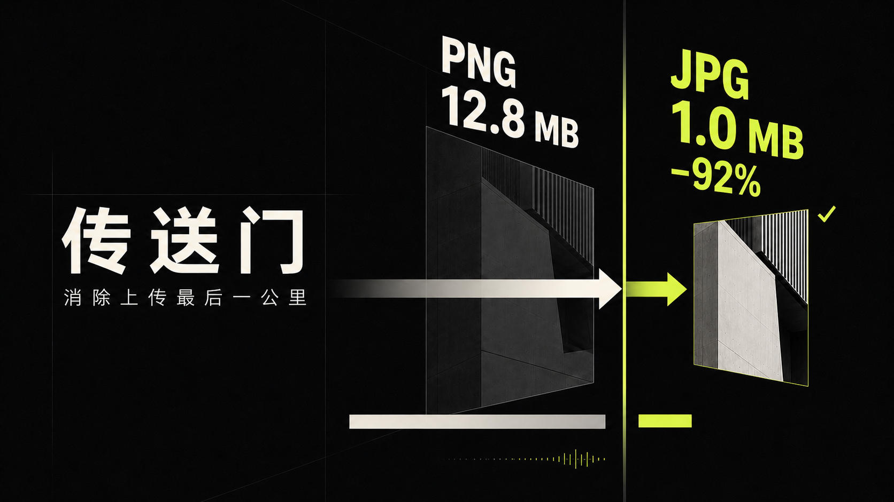

# 传送门

> **AI 读懂上传墙，本地引擎安全地跨过去。**

传送门是一款运行在 Tabbit Browser 中的智能上传适配工具。它不替代网站，也不要求用户离开当前页面，而是在文件因格式、体积、尺寸等要求无法上传时，自动理解网页规则，在浏览器本地完成必要的转换或压缩，再把合规文件放回原上传框。

**它解决的不是“如何压缩文件”，而是“如何让文件顺利抵达原本要去的地方”。**

---

## 上传失败，往往发生在最后一步

报名材料已经准备好，证件照却超过 1 MB；图片内容没有问题，网站只接受 JPEG；几小时的会议录音等待转写，却被格式或体积上限拦住。

用户真正想做的是提交材料、发布内容或开始转写，并不想临时学习图片格式、音频码率和压缩参数。但传统处理流程往往要求用户：

1. 离开当前网页；
2. 寻找第三方转换工具；
3. 再次上传自己的文件；
4. 猜测压缩参数并下载结果；
5. 返回原网站，重新寻找上传入口。

传送门希望消除的，正是这段繁琐、割裂且伴随隐私顾虑的“上传最后一公里”。

---

## 不改变原流程，只让文件原地适配

使用传送门时，用户仍然按照网站原本的方式选择文件。

当文件已经符合要求，传送门不会进行多余处理；当文件被格式墙、体积墙或图片尺寸要求拦住时，它会读取当前上传入口的规则，说明文件差在哪里、准备如何处理，并在需要有损转换时等待用户确认。

处理完成后，传送门会再次检查输出结果。只有格式、体积和相关参数真正满足网页要求，文件才会回到原上传框。最终的上传、提交、发布或转写操作，仍由用户亲自完成。

整个过程不需要打开新的压缩网站，也不需要反复下载和重新选择文件。

---

## 核心能力

### 图片无感适配

传送门以网页图片上传场景为核心，支持 JPEG、PNG、WebP 的格式检查与必要转换，并可根据页面明确要求完成：

- 图片格式转换；
- 文件体积压缩；
- 宽高与尺寸调整；
- 图片方向修复；
- 处理结果复检与原位回填。

对于裁剪、放大、透明背景变化等可能影响画面内容的操作，传送门不会静默执行，而会先向用户说明影响。

### 音频格式与体积适配

面对转写平台、会议纪要工具等常见音频上传场景，传送门可以：

- 将超出体积上限的 MP3 重新编码为更小的 MP3；
- 在网页明确允许 MP3 时，将常见 PCM WAV 转换为 MP3；
- 将已支持范围内的 AAC-LC M4A 转换为 MP3；
- 根据音频时长和网页上限计算合理码率；
- 在处理后重新验证格式、体积、时长与音频参数。

传送门只解决格式和体积障碍。若网页限制的是录音时长，它不会通过偷偷裁剪内容来伪造合规结果。

### 动态理解网页上传规则

上传要求往往散落在不同位置：上传框属性、附近提示、帮助文字，甚至是一闪而过的拒收弹窗。

传送门会把这些信息整理为可执行规则，包括允许格式、最大体积、图片尺寸、比例和音频时长等，并保留规则来源与原文证据。若要求互相矛盾或不足以安全执行，它会明确停止，而不是猜测处理。

---

## AI 真正参与了什么

传送门中的 AI 不是装饰性的对话入口，也不是负责压缩文件的黑盒。

确定性程序会优先读取网页中明确的格式、数字和单位；当自然语言要求较复杂、表达分散或存在歧义时，Tabbit AI 才会参与，将与当前上传入口相关的文字整理为结构化候选规则。

AI 的输出还必须经过本地证据、数值范围和规则冲突校验，才能进入后续流程。它不能直接处理文件、触发回填或代替用户提交。

这种分工让 AI 负责理解，让确定性引擎负责执行：既发挥自然语言能力，又保留可解释、可验证的安全边界。

---

## 五步跨过上传墙

1. **发现入口**：识别当前页面及动态出现的文件上传框。
2. **理解规则**：读取格式、体积、尺寸、比例或时长要求，必要时由 AI 补充理解。
3. **检查文件**：判断文件是否已经合规，以及真正阻碍上传的条件。
4. **本地适配**：经用户确认后，在浏览器本地执行最少必要的转换或压缩。
5. **复检回填**：验证结果满足规则后，放回原上传框，由用户继续网站原流程。

---

## 典型使用场景

### 报名与政务材料

照片内容已经正确，却因 JPEG、PNG、文件大小或尺寸要求无法提交。传送门在原页面完成必要适配，减少临时寻找图片工具的成本。

### 内容发布与商品素材

后台上传框对图片格式和体积有明确限制。传送门读取当前规则，尽可能用最小改动生成合规版本，避免用户反复导出素材。

### 录音转写与会议纪要

长录音常因 MP3、WAV、M4A 格式差异或单文件体积上限无法进入转写平台。传送门根据页面要求转换或重新编码，让用户在原入口继续任务。

---

## 隐私不是附加功能

图片像素、音频内容和处理结果均留在浏览器本地，不上传到传送门的服务器。

AI 只接收经过筛选和长度限制的网页规则文字，不接收图片、录音、文件名、媒体内容或完整网页。传送门也不会替用户点击“提交”“发布”“付款”或“开始转写”等业务按钮。

用户始终保留原文件、处理确认权和最终提交权。

---

## 产品边界

传送门专注于机器可验证的格式、体积、图片尺寸和部分音频参数，不尝试绕过网站的业务规则。

它不能替代证件照官方审核、人脸核验或网站指定的专用质量工具；不能解决账号权限、网络故障和服务端额度问题；不会自动裁剪超时音频，也不承诺支持所有 M4A 编码类型、加密媒体或损坏文件。

当规则不明确、要求互相冲突或安全处理无法保证结果时，传送门会诚实停止。

---

## 为什么叫“传送门”

它不是目的地，也不试图成为另一个庞大的文件工作台。

它只在用户与目标之间出现一道障碍时打开：让不合规的文件经过一次透明、可控的本地适配，直接抵达原本要去的上传入口。

**不打断任务，不带走文件，不替用户做决定。**

**传送门——消除上传最后一公里。**
